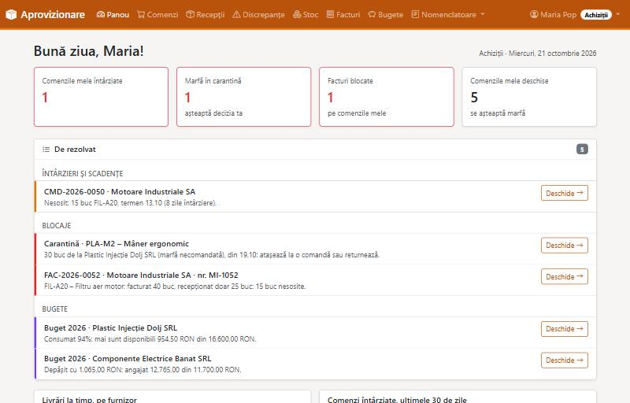
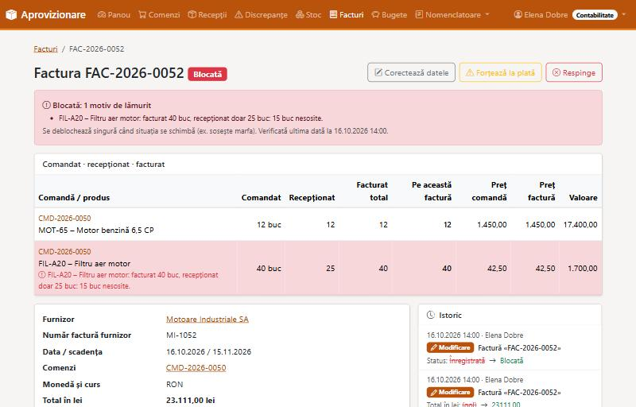
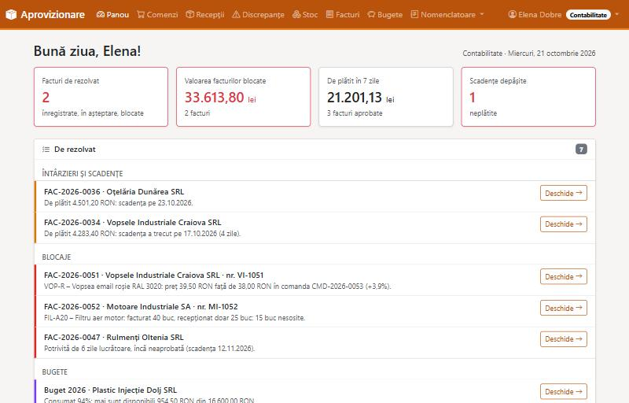
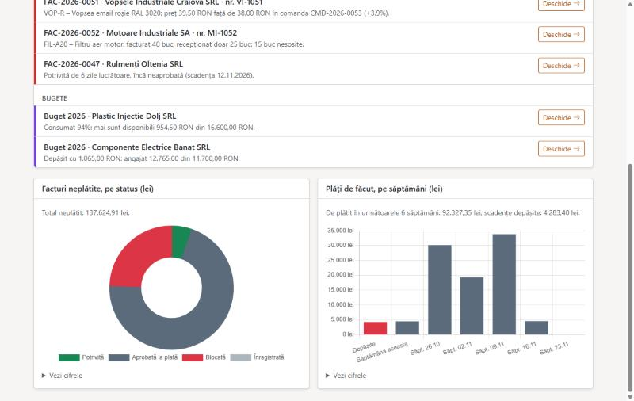
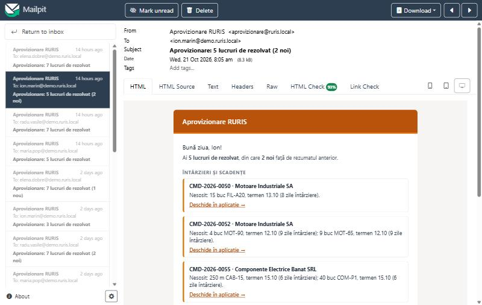
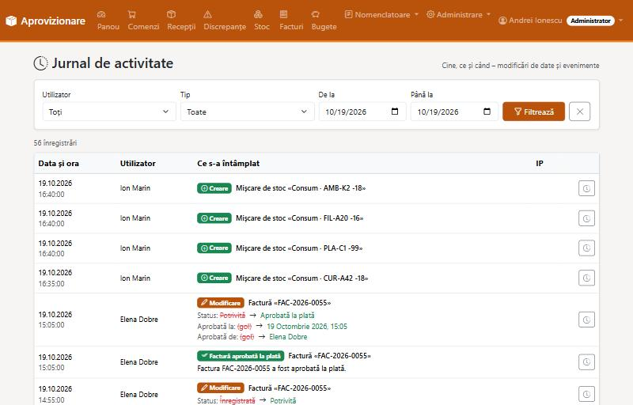

# Flux de aprovizionare · RURIS

[](https://github.com/ionutdinica/ruris-flux-aprovizionare/actions/workflows/ci.yml)

Aplicație web internă care leagă **Achizițiile**, **Depozitul** și **Contabilitatea** într-un singur flux:

**Comandă → Recepție → Factură → Plată**

Fiecare echipă vede ce o privește, iar aplicația spune singură ce întârzie și ce e blocat. O
factură ajunge la plată doar dacă se potrivește cu ce s-a comandat **și** cu ce a sosit efectiv
în depozit (potrivire în 3 direcții, *three-way match*).

## Cerințele și cum sunt rezolvate

| Cerința | Rezolvare |
|---|---|
| **Conturi pe echipă, fiecare vede doar ce o privește; audit** (cine, ce, când) | 4 roluri, o matrice de permisiuni verificată pe server la fiecare cerere (Depozitul nu vede prețuri); jurnal de audit cu modificările câmp cu câmp și evenimentele de business; istoricul fiecărui document |
| **Emailuri periodice despre ce întârzie și ce e blocat** | un rezumat zilnic pe persoană, doar cu problemele ei (comenzi întârziate, facturi blocate, marfă în carantină, scadențe), cu marcajul **NOU**; nimic de rezolvat → niciun email |
| **Facturi în RON / EUR, convertite la cursul din ziua facturii, preluat automat** | cursul BNR descărcat zilnic; factura de sâmbătă primește cursul de vineri; o factură de azi, înainte de publicarea BNR, așteaptă și se finalizează singură; niciun curs inventat |
| **Livrare într-un repository Git** | acest repository: cod, ~1.000 de teste, CI pe GitHub, documentație, pornire cu o singură comandă |

Plus: potrivirea comandă–recepție–factură (o factură blocată **se deblochează singură** când sosește
marfa), registru de stoc, carantină pentru marfa necomandată, import / export Excel, panou pe rol
cu grafice.

## Capturi de ecran

**Panoul Achizițiilor**: ce e de rezolvat și cât de punctuali sunt furnizorii


**Potrivirea unei facturi**: comandat · recepționat · facturat, pe fiecare linie


**Panoul Contabilității**: facturi blocate, scadențe, sume de plată



**Rezumatul zilnic pe email** (în Mailpit, căsuța de test): fiecare primește doar problemele lui


**Jurnalul de audit**: cine, ce și când, cu modificările câmp cu câmp


## Pornire (o singură comandă)

Cerință: [Docker Desktop](https://www.docker.com/products/docker-desktop/) (gratuit; Windows, macOS, Linux).

```bash
git clone https://github.com/ionutdinica/ruris-flux-aprovizionare.git
cd ruris-flux-aprovizionare
docker compose up --build
```

Prima pornire durează câteva minute: Docker descarcă imaginile (Python, PostgreSQL), apoi se
generează automat **date demo**: ~4 luni de activitate, 8 furnizori, ~65 de comenzi, ~55 de
facturi, cu fiecare situație din cerință (e nevoie de internet, pentru cursurile BNR). Aplicația
e gata când în terminal apare `Pornesc: gunicorn`. Apoi:

| Ce | Unde |
|---|---|
| Aplicația | http://localhost:8000 |
| Emailurile trimise (Mailpit) | http://localhost:8025 |

Parola pentru toate conturile: **`demo-ruris`** (aplicația rulează doar pe calculatorul tău, cu date inventate).

| Cont | Rol |
|---|---|
| `maria.pop`, `radu.vasile` | Achiziții (fiecare își vede comenzile lui) |
| `ion.marin` | Depozit |
| `elena.dobre` | Contabilitate |
| `andrei.ionescu` | Administrator |

Oprire: `docker compose down` (datele rămân) · de la zero, cu date demo proaspete:
`docker compose down -v` și din nou `docker compose up --build`.

**Ce să încerci:** ghidul [docs/07-ghid-demonstratie.md](docs/07-ghid-demonstratie.md) parcurge
aplicația pe roluri în ~10 minute. Momentul cel mai interesant: ca Depozit, recepționează
filtrele lipsă de la Motoare Industriale, iar factura blocată a Contabilității devine singură
„Potrivită”.

## Documentație

| Document | Conținut |
|---|---|
| [Ipoteze](docs/01-ipoteze.md) | deciziile luate acolo unde cerința nu e explicită |
| [Modelul de date](docs/02-model-date.md) | entitățile, relațiile și câmpurile |
| [Fluxuri și stări](docs/03-fluxuri-si-stari.md) | fluxul între echipe și ciclul de viață al documentelor |
| [Roluri și permisiuni](docs/04-permisiuni.md) | cine ce vede și ce poate face |
| [Reguli de business](docs/05-reguli-business.md) | potrivirea facturilor, cursul BNR, întârzieri, blocaje, notificări, indicatori |
| [Arhitectura](docs/06-arhitectura.md) | cum e construită aplicația și de ce |
| [Ghid de demonstrație](docs/07-ghid-demonstratie.md) | scenariul de prezentare și întrebările probabile |

## Tehnologii

Python 3.13 · **Django 5.2** · **PostgreSQL 17** · HTMX · Bootstrap 5 · Chart.js · django-auditlog ·
openpyxl (Excel) · Docker · pytest · ruff · GitHub Actions.

## Teste și calitate

- **~1.000 de teste** automate, pe PostgreSQL: regulile de business, paginile, permisiunile (fiecare
  pagină × fiecare rol, verificat automat) și un test cap-coadă al fluxului complet.
- **Acoperire 97%**, cu prag minim de 95%.
- **CI** la fiecare modificare: stilul codului, testele, pasul de producție pentru fișierele
  statice, migrațiile uitate, imaginea Docker.

## Pentru dezvoltatori

Aplicația din Python, cu baza de date și Mailpit din Docker (Python 3.12+):

```bash
docker compose up -d db mailpit   # PostgreSQL (portul 5433) + Mailpit (http://localhost:8025)
python -m venv .venv
.venv\Scripts\activate            # Windows  (Linux/macOS: source .venv/bin/activate)
pip install -r requirements-dev.txt
copy .env.example .env            # apoi completează SECRET_KEY în .env (Linux/macOS: cp)
python manage.py migrate
python manage.py seed_demo --if-empty --password demo-ruris   # date demo, dacă baza e goală
python manage.py runserver
```

Alte comenzi:

```bash
python manage.py run_scheduler    # job-urile periodice: cursul BNR, rezumatul zilnic pe email
pytest                            # testele (pytest --cov: cu raport de acoperire)
ruff check . && ruff format .     # stilul codului
```

Structura: fiecare zonă a afacerii e un modul în `apps/` (`purchasing`, `warehouse`,
`invoicing`, `currency`, `notifications`, `dashboard`, `audit` etc.), cu regulile de business în
`services.py`, separate de pagini. Detalii în [Arhitectura](docs/06-arhitectura.md).

## Ce aș face mai departe

- **e-Factura (ANAF SPV):** preluarea automată a facturilor primite, în locul introducerii manuale.
- **Plăți:** exportul ordinelor de plată pentru bancă (sau integrare directă) pentru facturile aprobate.
- **Valoarea stocului:** evaluare FIFO / cost mediu ponderat, pe lângă cantități.
- **Comenzi trimise automat furnizorilor** (email cu PDF-ul comenzii) și confirmarea lor.
- **Autentificare cu conturile firmei** (Microsoft 365 / Active Directory), fără parole separate.
- **Producție:** server intern cu backup automat al bazei de date, HTTPS și serverul de email al firmei.
