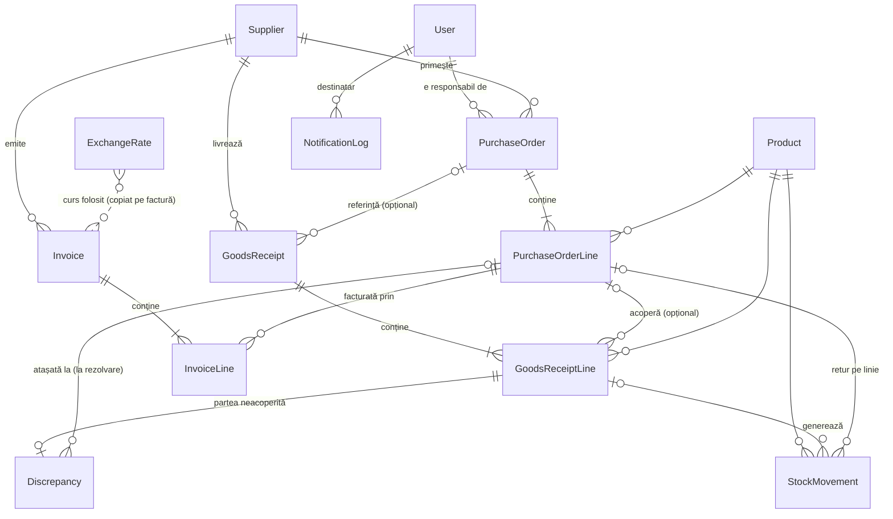

# 02 · Modelul de date

Numele modelelor și câmpurilor sunt în engleză (ca în cod); descrierile sunt în română.
Convenții generale:

- toate sumele și cantitățile sunt `Decimal` (niciodată `float`):
  - cantități: 3 zecimale (pentru UM precum kg, m)
  - prețuri unitare: 4 zecimale
  - valori (totaluri): 2 zecimale
  - curs valutar: 4 zecimale (precizia BNR)
- fiecare model are `created_at` și `updated_at` (modelul abstract `TimeStampedModel`); **cine** a creat sau modificat și **ce** anume se află în jurnalul de audit;
- documentele (comenzi, recepții, facturi) au un **număr intern** generat automat: `CMD-2026-0001`, `REC-2026-0001`, `FAC-2026-0001`.

## Diagrama entităților

## Entități

### Utilizatori și nomenclatoare

**User** – extinde utilizatorul Django
| Câmp | Tip | Observații |
|---|---|---|
| `username`, `email`, `first_name`, `last_name` | text | emailul e obligatoriu (notificări) |
| `role` | enum | `PROCUREMENT`, `WAREHOUSE`, `ACCOUNTING`, `ADMIN` |
| `is_active` | bool | utilizatorii nu se șterg, se dezactivează |

**Supplier** – furnizor
| Câmp | Tip | Observații |
|---|---|---|
| `name` | text | |
| `country` | cod ISO, 2 litere | implicit `RO` |
| `tax_id` | text, unic | pentru `RO`: CUI validat cu cifra de control și salvat fără prefixul RO (`RO14399840` = `14399840`); pentru alte țări: codul de TVA |
| `email`, `phone`, `address` | text | |
| `default_currency` | enum `RON`/`EUR` | propusă automat la comenzi noi |
| `is_active` | bool | |

**Product** – produs
| Câmp | Tip | Observații |
|---|---|---|
| `code` | text, unic | |
| `name` | text | |
| `unit` | enum | `buc`, `kg`, `m`, `l`, `set` … |
| `vat_rate` | decimal | doar cotele în vigoare: 21% (implicit), 11%, 0% |
| `description` | text | opțional |
| `is_active` | bool | |

### Achiziții

**PurchaseOrder** – comandă
| Câmp | Tip | Observații |
|---|---|---|
| `number` | text, unic | `CMD-AAAA-NNNN` |
| `supplier` | → Supplier | |
| `owner` | → User | responsabilul (primește notificările) |
| `currency` | enum | `RON`/`EUR` |
| `order_date` | dată | |
| `expected_date` | dată | implicit pentru linii |
| `status` | enum | vezi [03-fluxuri-si-stari.md](03-fluxuri-si-stari.md) |
| `close_reason` | text | obligatoriu la închidere cu rest nelivrat |
| `notes` | text | |

**PurchaseOrderLine** – linie de comandă
| Câmp | Tip | Observații |
|---|---|---|
| `order` | → PurchaseOrder | |
| `product` | → Product | |
| `quantity` | decimal(3) | > 0 |
| `unit_price` | decimal(4) | în moneda comenzii |
| `vat_rate` | decimal | preluat din produs, modificabil |
| `expected_date` | dată | |

Valori **calculate** (nu se stochează, ca să nu se poată desincroniza; se calculează prin agregări în interogări):
- `received_qty` = Σ cantități acoperite din recepții confirmate + Σ discrepanțe atașate − Σ retururi pe linie
- `invoiced_qty` = Σ cantități pe facturi nerespinse
- `remaining_qty` = `quantity` − `received_qty`
- `is_late` = `expected_date` < azi și `remaining_qty` > 0 și comanda e deschisă

### Depozit

**GoodsReceipt** – recepție
| Câmp | Tip | Observații |
|---|---|---|
| `number` | text, unic | `REC-AAAA-NNNN`, dat **la confirmare** (o ciornă greșită se poate șterge fără goluri în numerotare) |
| `supplier` | → Supplier | |
| `purchase_order` | → PurchaseOrder, opțional | gol = marfă fără comandă |
| `receipt_date` | dată | |
| `delivery_note` | text | nr. aviz / CMR de la transportator |
| `status` | enum | `DRAFT`, `CONFIRMED` |
| `confirmed_by`, `confirmed_at` | | |

**GoodsReceiptLine** – linie de recepție
| Câmp | Tip | Observații |
|---|---|---|
| `receipt` | → GoodsReceipt | |
| `product` | → Product | |
| `order_line` | → PurchaseOrderLine, opțional | |
| `quantity_received` | decimal(3) | ce s-a numărat efectiv |
| `quantity_accepted` | decimal(3) | calculat la confirmare: partea acoperită de comandă |
| `quantity_quarantined` | decimal(3) | calculat la confirmare: restul |
| `notes` | text | de ex. „ambalaj deteriorat” |

**Discrepancy** – discrepanță
| Câmp | Tip | Observații |
|---|---|---|
| `receipt_line` | → GoodsReceiptLine | |
| `type` | enum | `UNORDERED` (necomandat), `OVER_DELIVERY` (peste comandă) |
| `quantity` | decimal(3) | cantitatea în carantină |
| `status` | enum | `OPEN`, `RESOLVED` |
| `resolution` | enum | `ATTACHED`, `RETURNED` |
| `attached_order_line` | → PurchaseOrderLine | la rezolvarea prin atașare |
| `resolution_note`, `resolved_by`, `resolved_at` | | |

**StockMovement** – mișcare de stoc (registru append-only)
| Câmp | Tip | Observații |
|---|---|---|
| `product` | → Product | |
| `type` | enum | `RECEIPT`, `DISCREPANCY_ACCEPTED`, `CONSUMPTION`, `SUPPLIER_RETURN`, `ADJUSTMENT` |
| `quantity` | decimal(3) | **cu semn**: + intrare, − ieșire |
| `date` | dată | |
| `receipt_line` | → GoodsReceiptLine, opțional | |
| `order_line` | → PurchaseOrderLine, opțional | linia de comandă pe care s-a făcut intrarea sau returul (doar pentru `RECEIPT`, `DISCREPANCY_ACCEPTED`, `SUPPLIER_RETURN`) |
| `discrepancy` | → Discrepancy, opțional | |
| `reason` | text | obligatoriu pentru consum, retur, ajustare |

Stocul disponibil al unui produs = Σ `quantity`. În carantină = Σ discrepanțe `OPEN`.

**Un singur registru pentru stoc și pentru progresul comenzilor:** cantitatea recepționată a unei linii de comandă = Σ mișcărilor legate de acea linie (recepții + marfă acceptată din carantină − retururi). Stocul și „recepționatul” nu se pot contrazice. Registrul e *append-only* (nu se modifică, nu se șterge), iar baza de date verifică semnul fiecărui tip de mișcare.

### Contabilitate

**Invoice** – factură
| Câmp | Tip | Observații |
|---|---|---|
| `internal_number` | text, unic | `FAC-AAAA-NNNN` |
| `supplier` | → Supplier | |
| `supplier_invoice_number` | text | unic împreună cu `supplier` (I-21) |
| `invoice_date`, `due_date` | dată | |
| `currency` | enum | `RON`/`EUR` |
| `declared_net`, `declared_vat`, `declared_total` | decimal(2) | de pe documentul fizic |
| `exchange_rate` | decimal(4) | 1 pentru RON |
| `exchange_rate_date` | dată | data efectivă a cursului BNR folosit |
| `total_ron` | decimal(2) | `declared_total` × `exchange_rate` |
| `status` | enum | vezi [03-fluxuri-si-stari.md](03-fluxuri-si-stari.md) |
| `match_result` | JSON | lista motivelor de blocare (cod + detalii) de la ultima potrivire |
| `matched_at` | dată-oră | |
| `status_changed_at` | dată-oră | de când e factura în statusul curent; actualizat automat la schimbarea statusului |
| `override_reason`, `approved_by`, `approved_at` | | forțare / aprobare |
| `paid_at`, `payment_reference` | | detaliile plății: vizibile doar Contabilității și Adminului, inclusiv în istoric |
| `rejection_reason` | text | motivul respingerii |

**InvoiceLine** – linie de factură
| Câmp | Tip | Observații |
|---|---|---|
| `invoice` | → Invoice | |
| `order_line` | → PurchaseOrderLine | linia de comandă facturată |
| `quantity` | decimal(3) | |
| `unit_price` | decimal(4) | |
| `vat_rate` | decimal | |
| `net_amount`, `vat_amount` | decimal(2) | calculate |

### Infrastructură

**ExchangeRate** – curs BNR
| Câmp | Tip | Observații |
|---|---|---|
| `date` | dată | data publicării BNR |
| `currency` | text | `EUR` (se salvează toate monedele din flux; folosim EUR) |
| `rate` | decimal(4) | RON pentru 1 unitate |
| `multiplier` | int | BNR folosește multiplicator pentru unele monede (ex. 100 HUF) |
| unic: (`currency`, `date`) | | registru: cursurile se adaugă, nu se modifică și nu se șterg |

**RateSync** – o interogare a BNR
| Câmp | Tip | Observații |
|---|---|---|
| `started_at` | dată-oră | momentul interogării |
| `url` | text | fișierul cerut (ultimele 10 zile sau arhiva unui an) |
| `success`, `error` | | rezultatul; eroarea, pe înțelesul utilizatorului |
| `rates_created`, `latest_date` | | câte cursuri noi a adus, cel mai recent curs din fișier |
| `triggered_by` | → User | gol = job-ul automat; altfel, cine a apăsat „Actualizează acum” |

Pe lângă diagnostic, `RateSync` deosebește „BNR nu a publicat încă” de „BNR nu publică azi” (vezi [05-reguli-business.md](05-reguli-business.md), §2).

**NotificationLog** – email trimis
| Câmp | Tip | Observații |
|---|---|---|
| `recipient` | → User | |
| `email` | text | adresa folosită la momentul trimiterii |
| `sent_at` | dată-oră | |
| `kind` | enum | `DAILY` (automat), `MANUAL` („Trimite acum”) |
| `subject`, `body_text` | text | ce s-a trimis (afișat în „Notificări trimise”) |
| `items` | JSON | cheile problemelor incluse (pentru marcajul „NOU” data viitoare) |
| `status` | enum | `SENT`, `FAILED` |
| `error` | text | |
| `triggered_by` | → User | cine a apăsat „Trimite acum” (gol la cele automate) |

Registru: înregistrările se adaugă, nu se modifică și nu se șterg.

**DailyDigestRun** – rularea rezumatului zilnic
| Câmp | Tip | Observații |
|---|---|---|
| `date` | dată, unică | ziua rezumatului: se face o singură dată pe zi, chiar dacă job-ul rulează la 10 minute |
| `started_at` | dată-oră | |
| `sent`, `failed`, `nothing_to_report` | int | bilanțul: trimise, eșuate, persoane fără nimic de rezolvat |

**DocumentSequence** – numerotarea documentelor
| Câmp | Tip | Observații |
|---|---|---|
| `prefix`, `year` | text, int | unic împreună: `CMD` / `REC` / `FAC` pe fiecare an |
| `last_value` | int | ultimul număr dat; numere consecutive, fără goluri (rândul e blocat în baza de date la fiecare număr nou) |

**Jurnal de audit**, din două surse afișate împreună, ca o singură cronologie:
- `LogEntry` (django-auditlog, automat): utilizator, acțiune (creare / modificare / ștergere), obiect, diferențe câmp cu câmp, dată-oră, IP;
- **BusinessEvent** (explicit): evenimentele de business, cu mesaj și detalii (ex. `invoice.force_approved`, cu justificarea și motivele ignorate). Registru: nu se modifică și nu se șterge.

| Câmp (`BusinessEvent`) | Tip | Observații |
|---|---|---|
| `timestamp`, `actor`, `remote_addr` | | când, cine, de unde |
| `event_type` | enum | ex. `order.sent`, `receipt.confirmed`, `invoice.rechecked`, `invoice.paid` |
| `message`, `data` | text, JSON | descrierea și detaliile (justificare, motive, referințe) |
| `content_type`, `object_id`, `object_repr` | | documentul vizat (pentru istoricul lui) |
