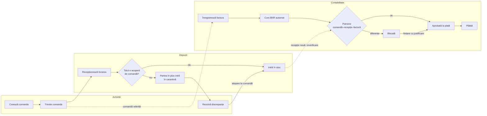
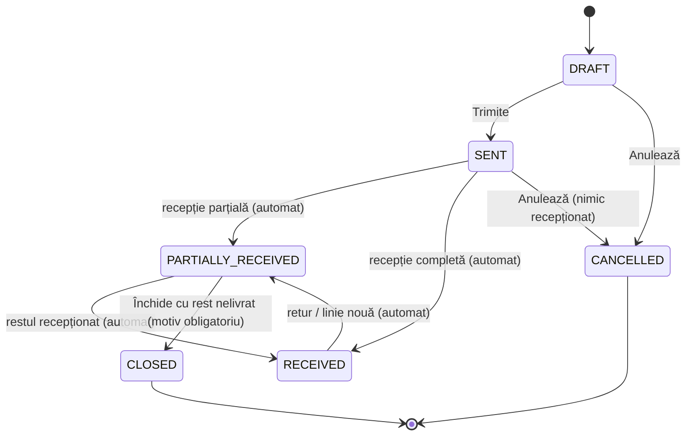
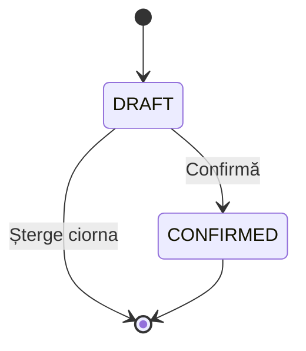
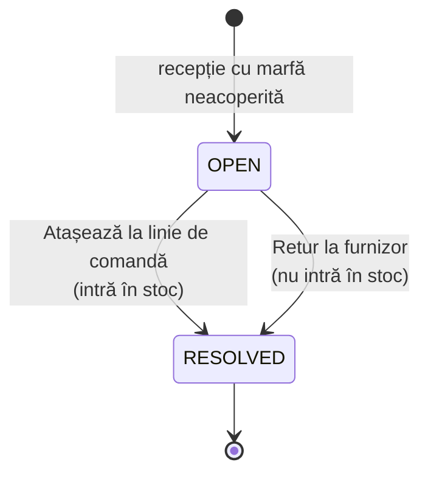
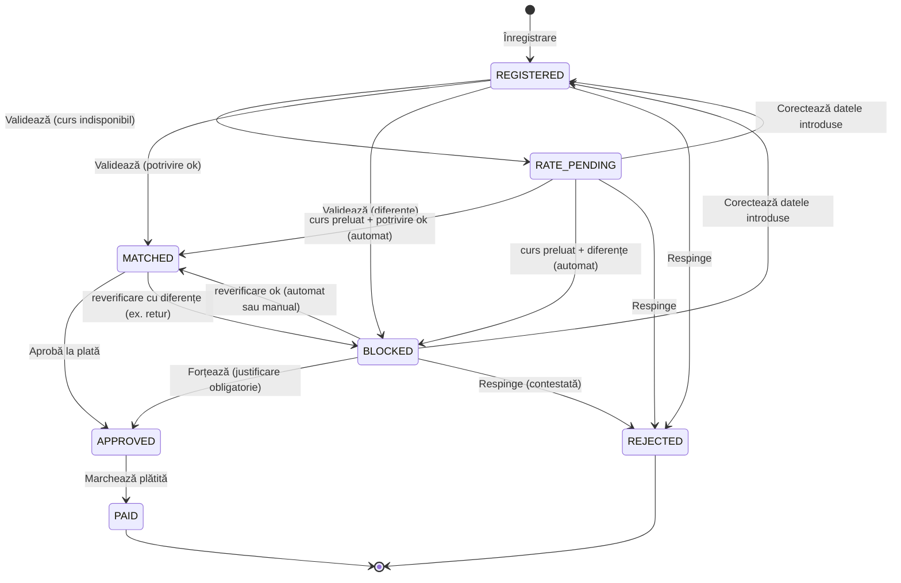

# 03 · Fluxuri și stări

## Fluxul general

Linia punctată de la recepție la potrivire este esențială: o factură blocată pentru că marfa „nu a sosit încă” se **deblochează singură** în momentul în care Depozitul confirmă recepția.

## Comanda (`PurchaseOrder.status`)

| Status | Etichetă | Se poate edita | Poate fi întârziată |
|---|---|---|---|
| `DRAFT` | Ciornă | tot | nu |
| `SENT` | Trimisă | data estimată, linii noi, cantități mai mari | da |
| `PARTIALLY_RECEIVED` | Parțial recepționată | idem | da |
| `RECEIVED` | Recepționată | linii noi, cantități mai mari (regularizarea unui surplus) | nu |
| `CLOSED` | Închisă | nu | nu |
| `CANCELLED` | Anulată | nu | nu |

Tranzițiile automate se recalculează după fiecare eveniment care schimbă cantitățile recepționate: confirmare de recepție, rezolvare de discrepanță, retur, linie adăugată.

## Recepția (`GoodsReceipt.status`)

Numărul `REC-…` se dă la confirmare. La **confirmare**, într-o singură tranzacție:
1. pentru fiecare linie: `accepted = min(primit, rest de recepționat pe linia de comandă)`, `quarantined = primit − accepted`;
2. se creează mișcarea de stoc `RECEIPT` pentru `accepted`;
3. dacă `quarantined > 0`, se creează o `Discrepancy` (`OVER_DELIVERY` sau `UNORDERED`);
4. se recalculează statusul comenzii;
5. se reverifică facturile blocate legate de comanda respectivă.

## Discrepanța (`Discrepancy.status`)

## Factura (`Invoice.status`)

| Status | Etichetă | Sens |
|---|---|---|
| `REGISTERED` | Înregistrată | introdusă, încă nevalidată; se poate edita |
| `RATE_PENDING` | Curs în așteptare | lipsește cursul BNR pentru data facturii |
| `MATCHED` | Potrivită | comandă, recepție și factură corespund |
| `BLOCKED` | Blocată | există cel puțin un motiv de blocare (vezi [05-reguli-business.md](05-reguli-business.md)) |
| `APPROVED` | Aprobată la plată | poate fi plătită |
| `PAID` | Plătită | final |
| `REJECTED` | Respinsă | contestată la furnizor; nu mai contează la cantitățile facturate |

Facturile `APPROVED` și `PAID` **nu se mai reverifică automat**: decizia de plată a fost luată și e consemnată.
