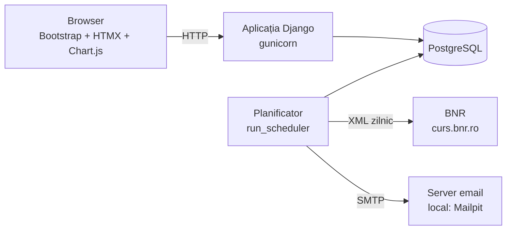
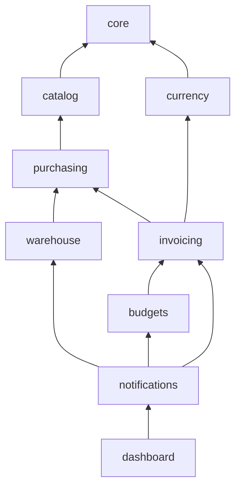
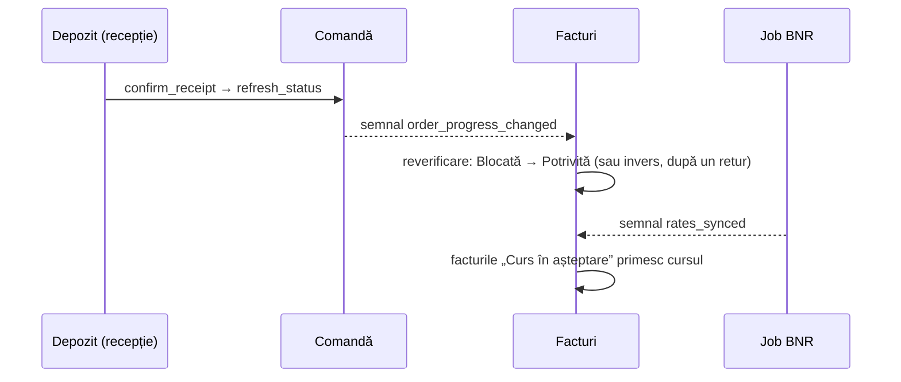

# 06 · Arhitectura

Cum e construită aplicația, cum se leagă piesele și de ce au fost alese așa.

## Pe scurt

O aplicație web **Django** (monolit modular), cu paginile randate pe server și interactivitate
punctuală prin **HTMX**, pe **PostgreSQL**. Logica de business stă în servicii testabile,
separat de pagini. Două job-uri periodice (cursul BNR, rezumatul pe email) rulează într-un
proces separat, **planificatorul**.

În Docker sunt patru containere: `db` (PostgreSQL), `web` (aplicația), `scheduler`
(job-urile) și `mailpit` (căsuța de email de test).

## Modulele (`apps/`)

Fiecare modul corespunde unei zone a afacerii și are aceeași structură.

| Modul | Rol |
|---|---|
| `accounts` | utilizatori, roluri și **matricea de permisiuni** (o singură sursă în cod) |
| `catalog` | furnizori (CUI validat) și produse |
| `purchasing` | comenzi, statusurile lor, import / export Excel |
| `warehouse` | recepții, carantină (discrepanțe), **registrul de stoc** |
| `invoicing` | facturi, **motorul de potrivire în 3 direcții**, aprobare, plată |
| `currency` | cursul BNR: descărcare, reguli de alegere a cursului |
| `budgets` | bugetele anuale pe furnizor, verificarea la trimiterea comenzii |
| `notifications` | detectorul de probleme, rezumatul zilnic pe email |
| `dashboard` | panoul pe rol: cifre-cheie, grafice, starea sistemului |
| `audit` | jurnalul de audit (cine, ce, când) și istoricul fiecărui document |
| `core` | piese comune: modele de bază, formatare în română, zile lucrătoare, planificatorul |
| `demo` | generatorul de date demo (`seed_demo`) |

`core`, `accounts` și `audit` sunt folosite de toate celelalte module.

Săgeata înseamnă „depinde de”. Dependențele merg într-un singur sens: comenzile nu știu
nimic despre facturi, iar cursul BNR nu știe nimic despre facturi. Legăturile în sens invers
se fac prin **semnale** (mai jos). La fel bugetele: comenzile nu știu de ele. Trimiterea din
pagină trece prin `budgets.services.send_order`, care verifică bugetul și apoi apelează
`purchasing.services.send_order`; cardul de buget apare pe paginile comenzii și furnizorului
printr-un *template tag* (``), ca istoricul din `audit`.

## Straturile unui modul

| Fișier | Ce conține | Regula |
|---|---|---|
| `models.py` | datele și validările lor; constrângerile importante sunt și **în baza de date** (unicitate, semne, date) | nu decide fluxuri |
| `services.py` | **regulile de business**: tranzițiile de status, recepția, potrivirea | singurul loc care schimbă statusuri; blochează rândurile în baza de date (`select_for_update`) |
| `selectors.py`, `alerts.py`, `metrics.py`, `matching.py` | interogări de citire, calcule | doar citesc: se pot rula oricând, fără efecte |
| `views.py` + `templates/` | paginile: formular → serviciu → răspuns | fără reguli de business; fiecare pagină declară o permisiune |
| `tests/` | teste pe reguli, pagini și permisiuni | |

De ce: regulile se pot testa fără browser și se refolosesc identic din pagini, din job-uri,
din importul Excel și din generatorul de date demo.

## Legăturile automate (semnale)

Așa o factură blocată pentru marfă nesosită **se deblochează singură** când Depozitul
confirmă recepția, iar modulul de depozit nu depinde de cel de facturi.

## Deciziile importante

| Decizie | De ce |
|---|---|
| **Django**, pagini randate pe server + **HTMX** | o aplicație internă cu formulare și tabele; un singur limbaj, fără un frontend separat de întreținut; HTMX pentru căutare live, filtre, completări automate |
| **PostgreSQL peste tot** (dezvoltare, teste, Docker, CI) | aceeași bază de date oriunde: nicio diferență „la mine merge” (o astfel de diferență a fost prinsă de CI) |
| **Registru de stoc nemodificabil** | stocul și „recepționatul” pe comandă se calculează din aceleași mișcări, deci nu se pot contrazice; corecturile sunt mișcări noi, vizibile |
| **Banii în `Decimal`**, rotunjire comercială | fără erori de rotunjire specifice numerelor reale (`float`) |
| **Permisiunile ca matrice în cod** | o singură sursă; un test compară codul cu documentația și unul verifică automat fiecare pagină pentru fiecare rol |
| **Jurnal de audit dublu** | modificările de câmpuri (automat, django-auditlog) + evenimentele de business explicite („factură forțată, cu justificare”); afișate împreună, ca o singură poveste |
| **Motorul de potrivire separat de interfață** | doar citește și raportează toate motivele; statusul îl decide serviciul; testabil exhaustiv |
| **„Primul venit, primul servit”** la facturi | două facturi nu pot fi potrivite simultan pe aceeași marfă; reverificarea e deterministă (docs/05, §1) |
| **Job-uri idempotente** + planificator simplu | job-ul știe singur dacă are ceva de făcut; poate rula oricând, oricât de des, fără dubluri |
| **Un singur detector de probleme** | emailul zilnic și panoul arată aceleași probleme, din aceeași sursă |
| **Fără găzduire online** | zero costuri, nimic de administrat; aplicația pornește la oricine cu o singură comandă, cu date demo |

## Siguranță

- Autentificare obligatorie pe toate paginile (`LoginRequiredMiddleware`); permisiuni verificate pe server la fiecare cerere, nu doar ascunse în interfață.
- Protecții Django standard: CSRF pe toate formularele și pe cererile HTMX, parole criptate, cookie-uri sigure în producție (HTTPS).
- Fișierele importate (Excel, XML-ul BNR) sunt citite cu protecție la construcții XML periculoase (`defusedxml`).
- Datele ajung la grafice prin `json_script`, nu prin text lipit în pagină: un nume de furnizor nu poate injecta cod.
- Istoricul unui document ascunde ce utilizatorul nu are voie să vadă (ex. detaliile plății pentru Achiziții).
- Testele nu pot accesa internetul (o plasă de siguranță le oprește).

## Calitate

- **~1.000 de teste** automate (reguli, pagini, permisiuni, un test cap-coadă), pe PostgreSQL; acoperire **97%**, cu prag minim de 95%.
- **CI pe GitHub** la fiecare modificare: stilul codului (ruff), testele, pasul de producție pentru fișierele statice, migrațiile uitate, imaginea Docker.
- Verificarea testelor înseși: regulile importante au fost „stricate” deliberat, iar testele trebuiau să pice.
